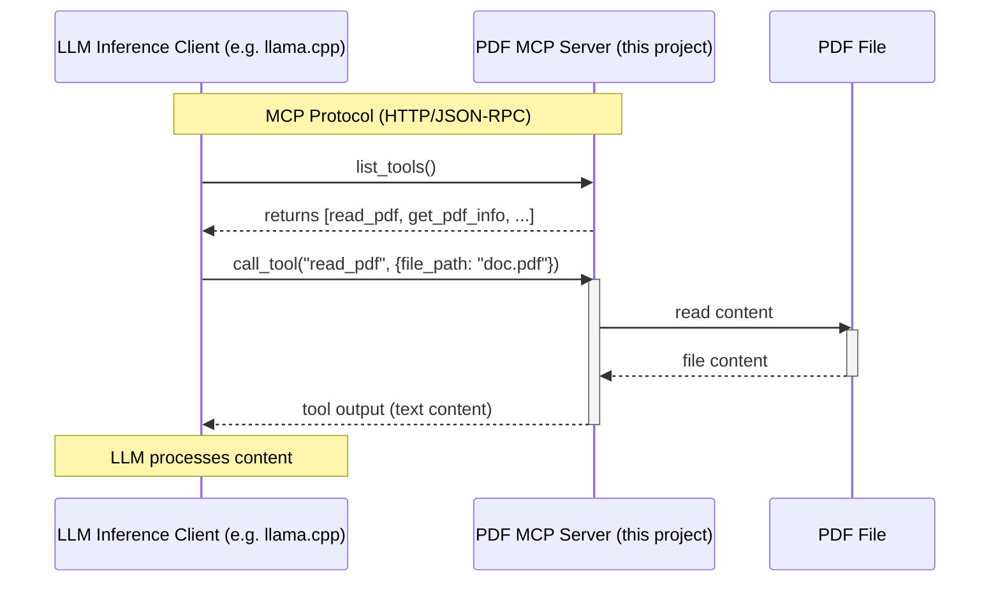

# PDF MCP Server



An MCP (Model Context Protocol) server that provides tools for reading and processing PDF files.


## Features

- **Read PDF**: Extract all text content from PDF files
- **Read PDF Page**: Extract text from a specific page of a PDF
- **Get PDF Info**: Retrieve metadata and information about PDF files (page count, file size, metadata, encryption status)
- **List PDFs**: List all PDF files in a directory


## Installation

Ensure you have Python 3.12+ and `uv` installed.

```bash
uv sync
```


## Deployment

### Docker deployment

```bash
# Build the Docker image
docker build -t pdf-mcp-server .

# Run the container
docker run -p 8001:8001 pdf-mcp-server
```

The server will be available at `http://localhost:8001/mcp`.


### read_pdf
Reads a PDF file and extracts all text content.

**Parameters:**
- `file_path` (string): Absolute or relative path to the PDF file

**Returns:** Extracted text content from all pages, or error message if file cannot be read


### read_pdf_page
Reads a specific page from a PDF file.

**Parameters:**
- `file_path` (string): Absolute or relative path to the PDF file
- `page_number` (integer): 1-based page number to read

**Returns:** Extracted text from the specified page, or error message


### get_pdf_info
Gets metadata and information about a PDF file.

**Parameters:**
- `file_path` (string): Absolute or relative path to the PDF file

**Returns:** Dictionary with PDF metadata including page count, metadata, file size, and encryption status


### list_pdfs
Lists all PDF files in a directory.

**Parameters:**
- `directory` (string): Absolute or relative path to the directory

**Returns:** List of PDF file paths found in the directory


## Project structure

- `main.py`: Entry point containing the FastMCP server definition and PDF tools
- `pyproject.toml`: Project configuration and dependencies
- `tests/`: Test suite with unit and integration tests
- `tests/fixtures/`: Sample PDF files for testing

## Local files

Both are committed:

- `.env`: local environment configuration, e.g. `PDF_STORAGE_DIR` (the directory
  where uploaded PDFs are stored).
- `storage/`: the runtime PDF storage directory — PDFs uploaded via
  `upload_pdf` are written here.


## Running tests

```bash
# Run all tests
uv run python -m pytest

# Run only unit tests
uv run python -m pytest tests/test_unit.py

# Run only integration tests
uv run python -m pytest tests/test_integration.py
```


## Example Usage

Once the server is running, you can use the MCP tools to interact with PDF files:

1. **List PDFs in a directory:**
   ```
   list_pdfs("/path/to/documents")
   ```

2. **Get information about a PDF:**
   ```
   get_pdf_info("/path/to/document.pdf")
   ```

3. **Read entire PDF:**
   ```
   read_pdf("/path/to/document.pdf")
   ```

4. **Read a specific page:**
   ```
   read_pdf_page("/path/to/document.pdf", 3)
   ```


## Notes

- The server uses `pypdf` for PDF processing
- Image-based PDFs (scanned documents) may not return text content
- Encrypted PDFs will report encryption status but cannot be read without decryption
- The server includes CORS middleware for browser-based clients


## Configuration

### Local (uv)

```json
{
  "$schema": "https://opencode.ai/config.json",
  "mcp": {
    "servers": {
      "pdf-mcp-server": {
        "type": "local",
        "command": ["uv", "run", "python", "main.py", "--host", "0.0.0.0", "--port", "8001"],
        "env": {
          "PYTHONPATH": "."
        }
      }
    }
  }
}
```

### Docker Compose

When running via Docker Compose, use `type: remote` to connect to the mapped port:

```json
{
  "$schema": "https://opencode.ai/config.json",
  "mcp": {
    "servers": {
      "pdf-mcp-server": {
        "type": "remote",
        "url": "http://localhost:8001/mcp"
      }
    }
  }
}
```

## Test review

Yes, the tests make sense overall — the suite (34 tests) covers the legacy tools and the new storage system, with real happy-path coverage on fixtures and error-path coverage for missing files. Caveats are noted inline where a test is weak, redundant, or fails to exercise what its name says.

| File / Method | Description | Purpose |
|---|---|---|
| test_unit.py :: test_read_pdf_file_not_found | read_pdf on a nonexistent path | Certify read_pdf returns "Error: File not found" |
| test_unit.py :: test_read_pdf_not_a_file | read_pdf("/tmp") | Certify read_pdf rejects non-file paths ("Path is not a file") |
| test_unit.py :: test_read_pdf_not_pdf_extension | read_pdf on a .txt file | Certify read_pdf rejects non-.pdf extensions |
| test_unit.py :: test_read_pdf_page_file_not_found | read_pdf_page on missing file | Certify read_pdf_page returns "Error: File not found" |
| test_unit.py :: test_read_pdf_page_invalid_page_number | read_pdf_page(nonexistent, 0) | Weak: passes the file-not-found branch; the page-0 range check is never exercised (covered only in integration tests) |
| test_unit.py :: test_get_pdf_info_file_not_found | get_pdf_info on missing file | Certify error dict contains "File not found" |
| test_unit.py :: test_get_pdf_info_not_a_file | get_pdf_info("/tmp") | Certify rejection of directories |
| test_unit.py :: test_get_pdf_info_not_pdf_extension | get_pdf_info on .txt | Certify rejection of non-PDF extension |
| test_unit.py :: test_list_pdfs_directory_not_found | list_pdfs("/nonexistent/directory") | Certify error entry "Directory not found" |
| test_unit.py :: test_list_pdfs_not_a_directory | list_pdfs(file path) | Certify "Error: Path is not a directory" |
| test_unit.py :: test_list_pdfs_empty_directory | list_pdfs(empty temp dir) | Certify "No PDF files found" |
| test_unit.py :: test_upload_pdf_invalid_filename | upload_pdf("malicious.exe") | Certify upload rejects non-.pdf extensions |
| test_unit.py :: test_upload_pdf_empty_content | upload_pdf("empty.pdf", "") | Weak: tautological OR assertion; side effect: creates storage/pdfs/empty.pdf |
| test_unit.py :: test_upload_pdf_invalid_base64 | upload_pdf("invalid.pdf", "not-base64-content!!!") | Weak: b64decode doesn't raise here, so the error path is never tested; only no-crash + cleanup asserted |
| test_unit.py :: test_delete_pdf_nonexistent | delete_pdf("never-existed.pdf") | Certify "Error: File not found" |
| test_unit.py :: test_read_pdf_defaults_to_storage | read_pdf() with patched STORAGE_DIR + fake PDF | Weak: loose assertions, doesn't verify default-storage selection |
| test_unit.py :: test_get_pdf_info_defaults_to_storage | get_pdf_info(None), patched, fake PDF | Weak: accepts "Error reading PDF info" on the fake file |
| test_unit.py :: test_list_pdfs_defaults_to_storage | list_pdfs() with patched STORAGE_DIR + test.pdf | Certify the default (patched) storage dir is listed |
| test_unit.py :: test_get_pdf_info_nonexistent | get_pdf_info("/tmp/nonexistent_file_12345.pdf") | Certify error dict "File not found" |
| test_unit.py :: test_delete_pdf_invalid_filename | delete_pdf("") | Certify "Error: File not found" |
| test_unit.py :: test_upload_pdf_path_traversal_logic | upload_pdf("../evil.pdf") | Certify basename sanitization; file lands at STORAGE_DIR/"evil.pdf"; uses double-negative assertion `assert not stored_path.parent != STORAGE_DIR` |
| test_integration.py :: test_read_pdf_integration | read_pdf(fixtures/sample1.pdf) | Certify real text extraction on a real fixture (non-empty result) |
| test_integration.py :: test_read_pdf_page_integration | read_pdf_page(sample1.pdf, 1) | Certify happy-path page read ("Page 1" or warning) |
| test_integration.py :: test_get_pdf_info_integration | get_pdf_info(sample1.pdf) | Certify info dict: page_count, file_path, file_size_bytes, file_size_mb, is_encrypted, metadata (page_count>0, size>0) |
| test_integration.py :: test_list_pdfs_integration | list_pdfs(fixtures_dir) | Certify finds sample1.pdf and lists without errors |
| test_integration.py :: test_read_pdf_multiple_samples | read_pdf over first 3 fixture PDFs | Weak: no positive assertions; accepts warnings |
| test_integration.py :: test_get_pdf_info_multiple_samples | get_pdf_info over first 3 fixtures | Weak: only asserts page_count>0, size>0, no errors |
| test_integration.py :: test_read_pdf_page_out_of_range | read_pdf_page(sample, page_count+1) | Certify "Error … out of range" |
| test_integration.py :: test_read_pdf_page_negative | read_pdf_page(sample, -1) | Certify "Error … out of range" |
| test_integration.py :: test_upload_pdf_integration | upload real sample bytes | Certify round-trip: path returned, file exists, size>0, content matches, read_pdf works on uploaded file |
| test_integration.py :: test_delete_pdf_integration | upload then delete | Certify "Successfully deleted", file gone; delete missing → "Error: File not found" |
| test_integration.py :: test_upload_path_traversal | upload_pdf("../evil.pdf", …) | Certify basename sanitization in the integration context |
| test_integration.py :: test_list_pdfs_defaults_to_storage | write test_default.pdf, list_pdfs() | Certify default listing includes the file; all listed paths have parent == STORAGE_DIR |
| test_integration.py :: test_upload_non_pdf | upload_pdf("malicious.exe", …) | Duplicate of unit #12 (same behavior, same assertion) |
