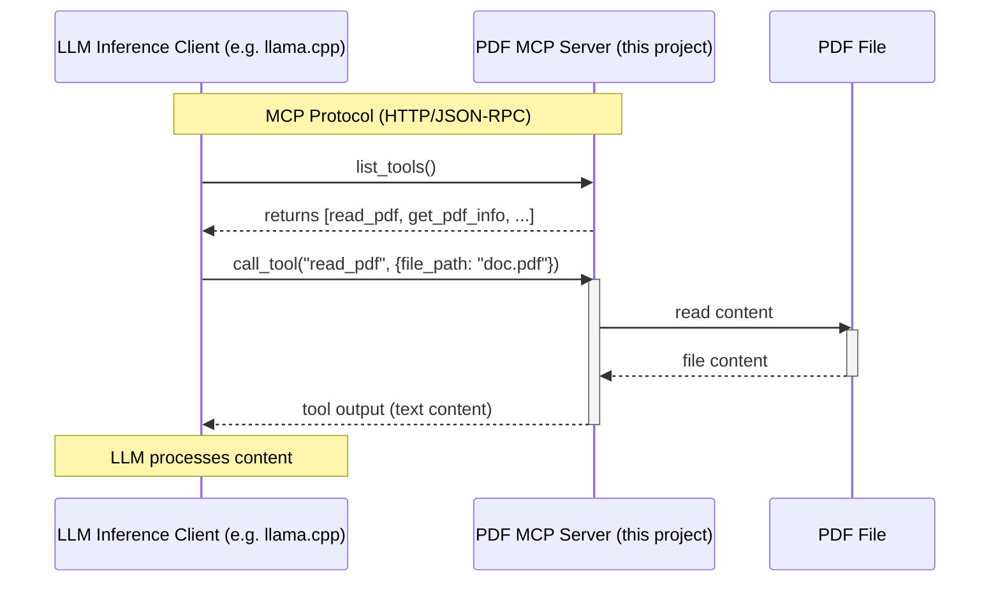

# PDF MCP Server



An MCP (Model Context Protocol) server that provides tools for reading and processing PDF files.


## Features

- **Read PDF**: Extract all text content from PDF files
- **Read PDF Page**: Extract text from a specific page of a PDF
- **Get PDF Info**: Retrieve metadata and information about PDF files (page count, file size, metadata, encryption status)
- **List PDFs**: List all PDF files in a directory

## Installation

Ensure you have Python 3.12+ and `uv` installed.

```bash
uv sync
```

## Deployment

### Docker deployment

```bash
# Build the Docker image
docker build -t pdf-mcp-server .

# Run the container
docker run -p 8001:8001 pdf-mcp-server
```

The server will be available at `http://localhost:8001/mcp`.

### read_pdf
Reads a PDF file and extracts all text content.

**Parameters:**
- `file_path` (string): Absolute or relative path to the PDF file

**Returns:** Extracted text content from all pages, or error message if file cannot be read

### read_pdf_page
Reads a specific page from a PDF file.

**Parameters:**
- `file_path` (string): Absolute or relative path to the PDF file
- `page_number` (integer): 1-based page number to read

**Returns:** Extracted text from the specified page, or error message

### get_pdf_info
Gets metadata and information about a PDF file.

**Parameters:**
- `file_path` (string): Absolute or relative path to the PDF file

**Returns:** Dictionary with PDF metadata including page count, metadata, file size, and encryption status

### list_pdfs
Lists all PDF files in a directory.

**Parameters:**
- `directory` (string): Absolute or relative path to the directory

**Returns:** List of PDF file paths found in the directory

## Project structure

- `main.py`: Entry point containing the FastMCP server definition and PDF tools
- `pyproject.toml`: Project configuration and dependencies
- `tests/`: Test suite with unit and integration tests
- `tests/fixtures/`: Sample PDF files for testing

## Running tests

```bash
# Run all tests
uv run python -m pytest

# Run only unit tests
uv run python -m pytest tests/test_unit.py

# Run only integration tests
uv run python -m pytest tests/test_integration.py
```

## Example Usage

Once the server is running, you can use the MCP tools to interact with PDF files:

1. **List PDFs in a directory:**
   ```
   list_pdfs("/path/to/documents")
   ```

2. **Get information about a PDF:**
   ```
   get_pdf_info("/path/to/document.pdf")
   ```

3. **Read entire PDF:**
   ```
   read_pdf("/path/to/document.pdf")
   ```

4. **Read a specific page:**
   ```
   read_pdf_page("/path/to/document.pdf", 3)
   ```

## Notes

- The server uses `pypdf` for PDF processing
- Image-based PDFs (scanned documents) may not return text content
- Encrypted PDFs will report encryption status but cannot be read without decryption
- The server includes CORS middleware for browser-based clients
